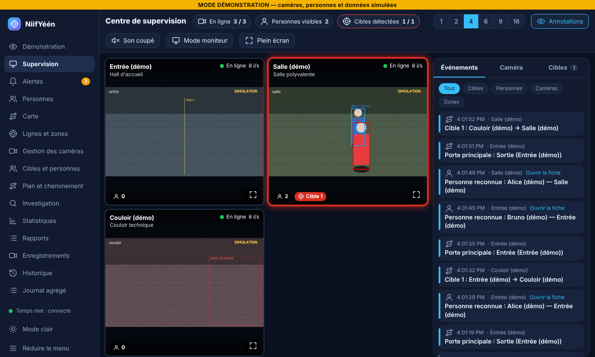
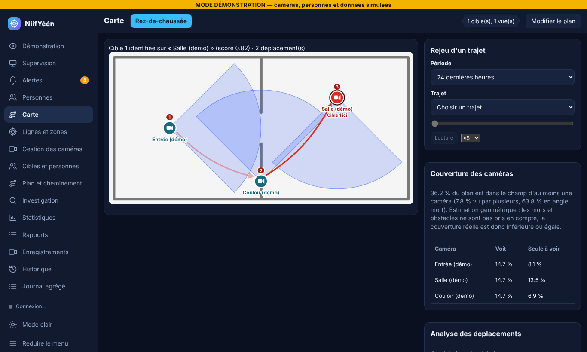
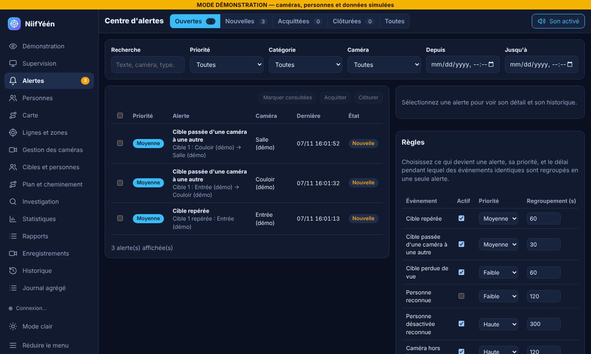

# NiifYéén

**Plateforme web de supervision vidéo multi-caméras** : détection de personnes, suivi d'une cible d'une caméra à l'autre, carte de ville avec les caméras, alertes sur les cibles. Le tout dans une interface en français, sans dépendance cloud.

Projet réalisé en Python (FastAPI) lors d'un hackathon, puis structuré en 14 modules. Les captures ci-dessous ont été prises avec des **caméras simulées** (silhouettes sans visage, personnes fictives) dans une version précédente du projet : elles montrent aussi des pages retirées depuis.



## Ce que fait le projet

| Domaine | Fonctions |
| --- | --- |
| **Supervision** | Mosaïque de 1 à 16 caméras, état en ligne / hors ligne, flux d'événements en direct, mode moniteur plein écran, caméras réparties sur plusieurs ordinateurs |
| **Détection et suivi** | Détection de personnes (YOLOv8) et suivi local (ByteTrack), ré-identification entre caméras |
| **Cibles** | Désigner une personne comme cible, la suivre sur plusieurs caméras, afficher son trajet sur le plan et le rejouer |
| **Alertes** | Alertes limitées aux cibles (option modifiable), priorités, regroupement des doublons, prise en charge par l'opérateur, notifications externes optionnelles |
| **Carte** | Carte d'Ouagadougou (ou plans par étage) avec les caméras placées, direction et champ de vision, trajet des cibles affiché sur la carte et rejoué dans l'historique |

<table>
<tr>
<td></td>
<td></td>
</tr>
</table>

## Pile technique

- **Backend** : Python 3.10+, FastAPI, Uvicorn (HTTP et WebSocket), SQLAlchemy 2 avec SQLite
- **Vision** : OpenCV, YOLOv8 et ByteTrack (Ultralytics), InsightFace (reconnaissance faciale, optionnelle)
- **Frontend** : HTML, CSS et JavaScript sans framework ni étape de build, avec thème clair / sombre et interface adaptée au mobile
- **Tests** : `unittest`, plus des tests de la logique JavaScript exécutés avec Node.js

## Architecture

```
Caméras (webcam, RTSP, flux d'un autre PC)
        │
   Capture + détection + suivi (un fil par caméra)
        │
   ┌────┴────────────────────────────┐
   │ Cibles · Suivi inter-caméras    │──► Fil d'événements ──► Alertes · WebSocket
   └────┬────────────────────────────┘                              │
        │                                                           ▼
   SQLite (détections, alertes, plans…)             Interface web (FastAPI + pages statiques)
```

Chaque module reste indépendant du navigateur : le suivi des cibles, les comptages et les alertes tournent côté serveur, que la page soit ouverte ou non. Le code est dans `backend/app/` (un fichier par domaine : `alerts.py`, `floors.py`…), les pages dans `backend/app/static/`.

## Lancer avec de vraies caméras

```powershell
Copy-Item cameras.example.json cameras.json     # facultatif : import initial des caméras
.\venv\Scripts\python.exe -m uvicorn backend.app.main:app --host 127.0.0.1 --port 8000
```

Les caméras se gèrent ensuite depuis la page « Gestion des caméras ». Le serveur écoute uniquement sur `127.0.0.1`. Le guide complet (configuration, variables d'environnement, caméras distantes, dépannage) est dans [docs/DOCUMENTATION.md](docs/DOCUMENTATION.md).

## Tests

```powershell
.\venv\Scripts\python.exe -B -m unittest discover -s tests -t . -v
```

516 tests, sans caméra ni modèle : suivi des cibles, alertes, migrations de base de données, API, validation des entrées. Un test vérifie aussi qu'aucune page n'utilise `innerHTML`.

## Choix de conception

- **Vie privée par défaut** : les notifications externes sont anonymes ; les identités n'apparaissent que dans les écrans nominatifs (investigation, fiche de la cible). Les secrets passent uniquement par des variables d'environnement.
- **Sécurité** : serveur local, plans importés assainis (SVG sans script), aucun `innerHTML`, validation stricte des entrées, adresses de flux jamais renvoyées en clair par l'API.
- **Migrations sans perte** : une ancienne base SQLite est mise à niveau au démarrage.

## Limites connues

- Prototype : la détection, le suivi et la reconnaissance n'ont **pas été évalués sur de vraies caméras** et les seuils ne sont pas calibrés.
- La couverture sur plan est géométrique : elle ignore murs et obstacles, c'est donc un maximum, et à l'échelle d'une ville elle n'a pas de sens physique.
- Le multi-sites n'est pas implémenté.
- Les notifications e-mail et Telegram ne sont testées qu'avec des simulations.
- Testé sous Windows avec Chromium ; Firefox et Safari ne sont pas vérifiés.

## Données personnelles et usage responsable

Le projet contient des fonctions de reconnaissance faciale. Il ne doit être utilisé qu'avec le **consentement des personnes enrôlées** et dans le respect de la réglementation locale sur la vidéosurveillance et les données biométriques. Aucune base, photo ni empreinte n'est fournie avec le code (voir `.gitignore`).

## Pour aller plus loin

[Documentation technique complète](docs/DOCUMENTATION.md) · [Plan de développement en 14 modules](docs/NIIFYEEN_2_0_PLAN.md)
